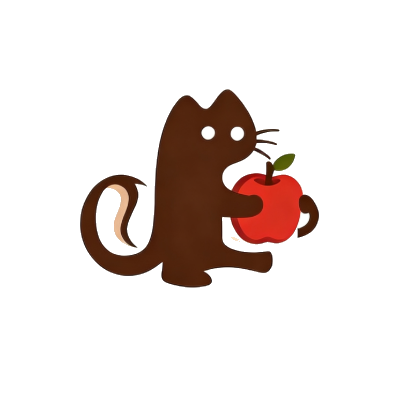

  

  
  
  
&nbsp;

  
  

  
&nbsp;

  

    &emsp;
    &emsp;
    &emsp;
    
  

  
&nbsp;

<h2 align="center"> 🍊 Who We Are? </h2>

<b>Fruit Guardians（果宝特攻）</b> 是由 <b><a href="https://www.hnusec.com">HnuSec</a></b>（海南大学安全团队）发起和维护的网络安全与 AI 攻防开源计划。我们汇聚了一批热爱安全攻防、前沿对抗与智能工程的技术探索者，深耕漏洞挖掘、静态代码分析、二进制逆向与大模型智能体（Security Agent）等领域。我们的宗旨是：<b>将竞赛实战、攻防对抗与学术积累中真正有价值的能力武器化、工程化，沉淀为开箱即用的开源工具与知识体系，赋能每一位安全研究者与学习者。</b>

<b>Fruit Guardians</b> is a cybersecurity and AI agent open-source initiative founded and maintained by <b><a href="https://www.hnusec.com">HnuSec</a></b>. We bring together passionate security researchers, CTF players, and AI engineers specializing in vulnerability hunting, CodeQL static analysis, binary exploitation, and autonomous security agents. Our mission is: <b>weaponizing real-world offensive-defensive capabilities into high-quality open-source toolkits, safeguarding the digital realm alongside the community.</b>

&nbsp;

<h2 align="center"> 🧭 Guide · 快速导航 </h2>

<table align="center" width="100%">
  <tr>
    <td align="center" width="36%">
      <b>🐣 你是一个不知道从哪儿开始学的安全小白？</b>
    </td>
    <td>
      从战队历届培训讲义与打卡作业入手，由浅入深构建攻防技能树： 
      👉 请看：<a href="https://github.com/Fruit-Guardians/2026-Autumn-Training">《HnuSec 2026 秋季培训实训体系》</a> 及 <a href="https://github.com/Fruit-Guardians/2025-autumn-learning">《历届专项学习记录》</a>
    </td>
  </tr>
  <tr>
    <td align="center">
      <b>🤖 你想探索 AI + 安全智能体实战落地？</b>
    </td>
    <td>
      体验多智能体协同渗透、自动化 CodeQL 规则生成与 LLM 审计流程： 
      👉 请看：<a href="https://github.com/Fruit-Guardians/ProofBlade">《ProofBlade 安全智能体》</a> 与 <a href="https://github.com/Fruit-Guardians/PureAutoCodeql">《PureAutoCodeql 漏洞挖掘流水线》</a>
    </td>
  </tr>
  <tr>
    <td align="center">
      <b>🏆 你在备战 CTF 比赛或需要实战辅助工具？</b>
    </td>
    <td>
      探索竞赛决策渗透运行时、CTF 平台架构与精选 WriteUp： 
      👉 请看：<a href="https://github.com/Fruit-Guardians/Izrail">《Izrail 竞赛决策多 Worker 渗透运行时》</a> 与 <a href="https://github.com/Fruit-Guardians/HnuCTF">《HnuCTF 赛事平台》</a>
    </td>
  </tr>
  <tr>
    <td align="center">
      <b>💻 你想为 Fruit Guardians 贡献代码或发起项目？</b>
    </td>
    <td>
      欢迎任何具有开源精神的伙伴添砖加瓦或立项共建： 
      👉 请看：<a href="https://github.com/orgs/Fruit-Guardians/repositories">《组织仓库列表》</a>，欢迎直接 Fork 提 PR，或在 <a href="https://github.com/orgs/Fruit-Guardians/discussions">Discussions</a> 交流创意！
    </td>
  </tr>
  <tr>
    <td align="center">
      <b>💬 你在使用工具中发现了 Bug 或有改进建议？</b>
    </td>
    <td>
      我们鼓励所有形式的沟通与反馈，发现问题也是对开源的一大贡献： 
      👉 请直接前往对应仓库的 Issue 提出，或在 <a href="https://github.com/orgs/Fruit-Guardians/discussions">Discussions 社区讨论区</a> 留言 ❤️
    </td>
  </tr>
</table>

&nbsp;

<h2 align="center"> 🔥 Trending · 重点开源项目 </h2>

<table align="center" width="100%">
  <tr>
    <td align="center" width="50%">
      
    </td>
    <td align="center" width="50%">
      
    </td>
  </tr>
  <tr>
    <td align="center">
      
    </td>
    <td align="center">
      
    </td>
  </tr>
  <tr>
    <td align="center">
      
    </td>
    <td align="center">
      
    </td>
  </tr>
  <tr>
    <td align="center">
      
    </td>
    <td align="center">
      
    </td>
  </tr>
</table>

&nbsp;

<h2 align="center"> 🔬 Research & Tech Stack · 研究矩阵与技术生态 </h2>

<table align="center" width="100%">
  <tr>
    <th width="33.3%" align="center">🛡️ 攻防对抗与漏洞挖掘</th>
    <th width="33.3%" align="center">🤖 AI × 攻防智能体</th>
    <th width="33.3%" align="center">🏗️ 武器化与工程基建</th>
  </tr>
  <tr>
    <td valign="top">
      <ul>
        <li><b>Web 漏洞挖掘</b>：链式利用构造、反序列化、逻辑缺陷</li>
        <li><b>二进制 & Pwn</b>：逆向分析、内存脆弱性、Exploit 编写</li>
        <li><b>密码学分析</b>：密码算法分析、弱随机性与侧信道研究</li>
        <li><b>数字取证溯源</b>：内存镜像取证、流量解密、入侵溯源</li>
      </ul>
    </td>
    <td valign="top">
      <ul>
        <li><b>Security Multi-Agent</b>：任务自主规划与协同渗透</li>
        <li><b>CodeQL 规则生成</b>：大模型驱动的代码语义与路径推导</li>
        <li><b>自动化 PoC 构造</b>：漏洞上下文自适应与有效性验证</li>
        <li><b>模型安全防御</b>：提示词注入拦截、Agent 沙箱安全治理</li>
      </ul>
    </td>
    <td valign="top">
      <ul>
        <li><b>静态分析插件</b>：Zed / IDE 深度语言服务与语法支持</li>
        <li><b>信息收集自动化</b>：前端静态资产与 API 端点深度探测</li>
        <li><b>CTF 竞技平台</b>：赛事题库沉淀、动态靶标与环境编排</li>
        <li><b>实训体系沉淀</b>：梯度式新人教程与攻防技能树建设</li>
      </ul>
    </td>
  </tr>
</table>

   
  

&nbsp;

<h2 align="center"> 💐 Fruit Guardians Family · 团队与贡献者 💐 </h2>

  
感谢每一位为 Fruit Guardians 持续投入热爱、创意与代码的伙伴：

   

&nbsp;

  

  <strong>Fruit Guardians · 用开源工具沉淀攻防能力，用智能工程守护数字世界</strong>
    
  🌐 官方主页 <a href="https://www.hnusec.com">hnusec.com</a> &nbsp;|&nbsp; 💬 社区讨论 <a href="https://github.com/orgs/Fruit-Guardians/discussions">Discussions</a> &nbsp;|&nbsp; 📦 开源项目 <a href="https://github.com/orgs/Fruit-Guardians/repositories">Repositories</a>
   
  一起见证星辰大海 ✨

